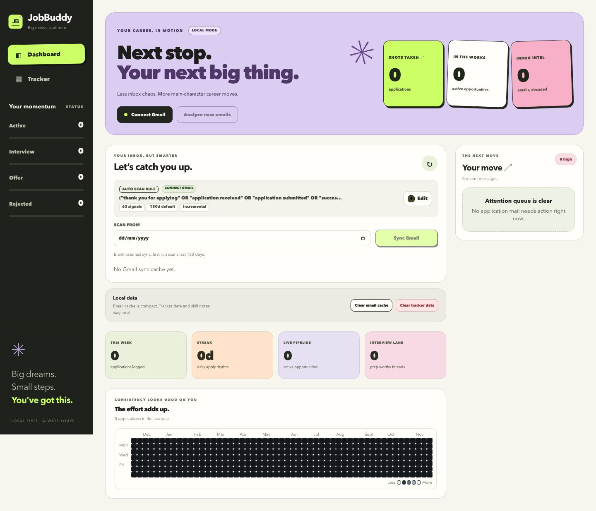
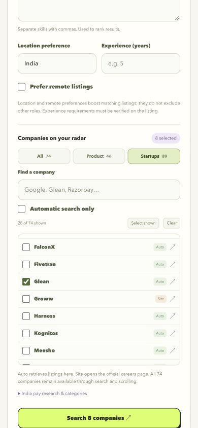
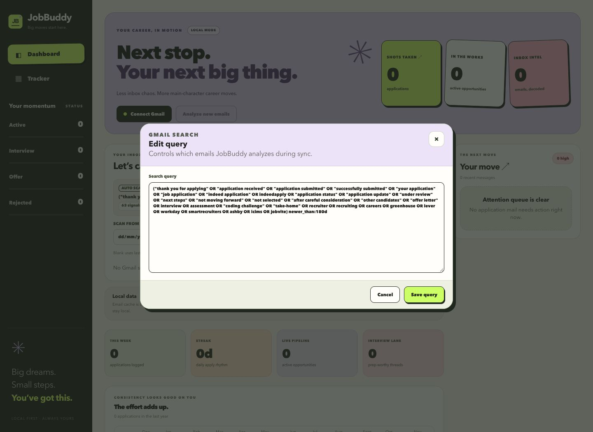
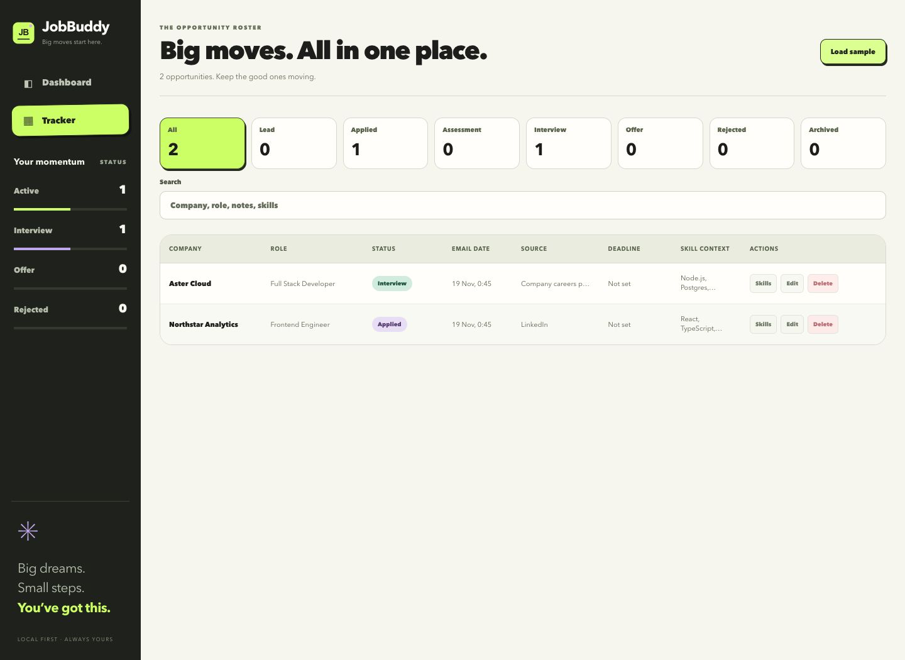
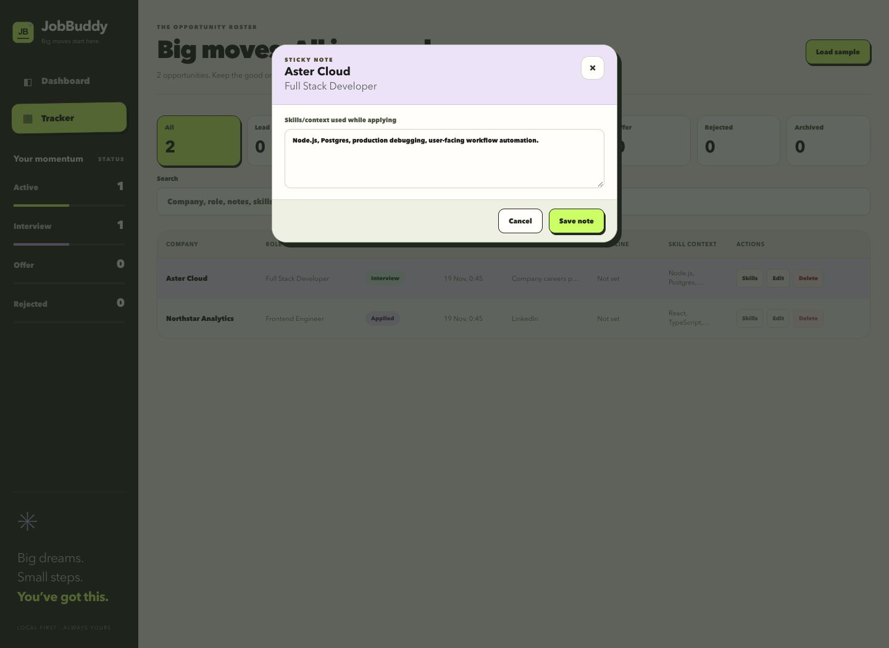
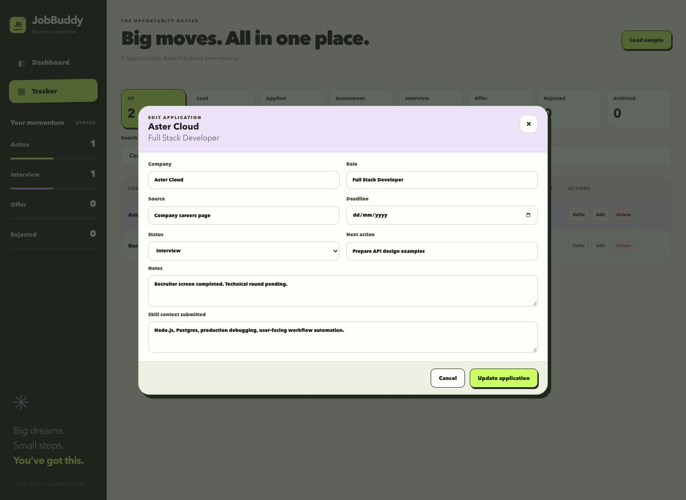
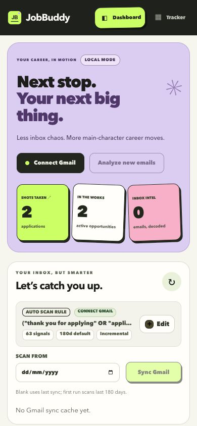

# JobBuddy

JobBuddy is a local-first React + TypeScript application for discovering opportunities and managing your job search from one workspace. It connects to Gmail with read-only access, scans application-related messages, classifies responses, builds a tracker automatically, and gives you an energetic lime, lilac, and pink workspace for pipeline status, attention items, notes, and submitted skill context.

The goal is simple: reduce manual job-application bookkeeping and make Gmail-driven application tracking feel fast, clear, and trustworthy.



## What JobBuddy Does

- Discovers roles across a 74-company India-focused directory, with separate Product and Startups categories, automatic retrieval for 44 companies, and official career-site links for 30 more.
- Ranks loaded listings using your preferred role, skill mentions, and location/remote preferences, then saves selected roles to the tracker as Leads.
- Syncs Gmail messages related to job applications using a configurable search rule.
- Analyzes application emails for status signals such as applied, assessment, interview, offer, rejection, follow-up, and needs review.
- Builds and updates a tracker automatically from synced emails.
- Keeps a local pipeline view for active, interview, offer, and rejected applications.
- Highlights recent application messages that need attention.
- Stores tracker data, notes, skill context, compact sync metadata, and the remembered Gmail connection locally in the browser.
- Supports manual editing when automated classification needs correction.
- Lets you save sticky-note style skill context for each application.
- Runs as a Vite React app in development or as a local production preview.

## Screenshots

Screenshots show the redesigned UI using an empty workspace, sample applications, or generic discovery preferences. No personal Gmail messages or account details are included.

### Discover And Company Directory

Discover includes a compact directory of 74 companies: 46 established product companies and 28 startups/scaleups. Search names, switch categories, filter automatic integrations, and select companies without triggering requests. **Auto** retrieves listings inside JobBuddy; **Site** provides the official career destination. Search runs on button click, with progressive four-company batches and a stop control.



The [complete company directory](docs/company-directory.md) includes every configured company, career destination, research source, and retrieval mode.

### Dashboard And Gmail Sync

The dashboard is the main operating screen. It contains Gmail connection actions, the automated scan rule, local data controls, key focus metrics, application activity, and the attention queue. The redesigned UI pairs a cream canvas and dark sidebar with bold typography, lilac panels, lime actions, and pink metric cards. Layouts adapt to desktop and mobile screens.


### Gmail Search Rule Editor

The Gmail query is hidden by default to keep the dashboard clean. Use the edit button when you want to fine-tune what JobBuddy scans. The modal uses lightweight transform/opacity animation so it opens smoothly without expensive backdrop blur.



### Tracker

The tracker is designed as a dense CRM-style table. JobBuddy can create rows from Gmail sync, and you can still load sample data, filter by status, search, edit, delete, open the source email, or add skill notes.



### Skill Context Notes

Each application can have a sticky-note style skill context entry. This is useful for saving the exact skills, resume angle, or project framing used while applying.



### Edit Application

Tracker rows can be edited through an in-place modal instead of a permanent manual form. This keeps the tracker focused on review and correction rather than data entry.



### Mobile Dashboard

The dashboard adapts to phone screens with compact navigation and stacked panels. The tracker keeps its table inside a horizontally scrollable panel.



## Tech Stack

- React 19
- TypeScript with strict compiler settings
- Vite with a local career-search endpoint for development and production preview
- Local storage persistence
- Gmail API integration through Google Identity Services
- Utility-first architecture: components stay mostly presentational, and application logic lives in typed utilities

## Project Structure

```text
src/
  components/
    layout/              Shared shell and navigation
  features/
    discovery/           Company directory, profile matching, job discovery
    dashboard/           Dashboard, analytics, attention queue, sync controls
    email/               Gmail sync UI and email analysis components
    notes/               Canvas-style notes workspace
    tracker/             CRM-style application tracker
  types/                 Strict domain types
  utils/                 Business logic, guards, Gmail parsing, storage, analytics
server/                  Local search endpoint, career-site connectors, normalization
shared/companies.json    Shared company directory and validated search configuration
docs/company-directory.md  Research sources and per-company search coverage
```

## Local Storage Model

JobBuddy is local-first. Data is stored in browser local storage under versioned keys:

```text
jobbuddy.applications.v1
jobbuddy.emailSignals.v1
jobbuddy.notes.v1
jobbuddy.gmailSyncCache.v1
jobbuddy.gmailAccessSession.v1
jobbuddy.discoveryProfile.v1
```

The app includes local clearing actions:

- Clear email cache: removes stored email signals and Gmail sync metadata.
- Clear tracker data: removes applications, email signals, notes, and sync metadata while keeping the remembered Gmail connection.

## Discover Jobs

Open **Discover**, enter a preferred role (or comma-separated skills), choose companies from the searchable **Product** and **Startups** directory, and click **Search N companies** (where N is your selection count). The full [company directory and research sources](docs/company-directory.md) lists all 74 entries and their retrieval modes. Opening the page or editing your profile never triggers a search. The role is the search keyword; if blank, the first skill is used.

- Results include the company, title, location, available summary/date information, evidence-based match reasons, and original career-site link.
- Skills and location/remote preferences rank the loaded results locally. They are preferences rather than hard filters. Experience is saved as a reference and must be checked against the full listing; the feeds do not consistently expose requirements.
- The compact picker includes all 74 companies, category tabs (46 product / 28 startup-scaleup), name search, an automatic-search filter, selection counts, Select shown and Clear. Existing saved selections are preserved.
- Automatic retrieval is configured for 44 companies; 30 have clearly labeled official career-site links. No background searches run when you browse or change the directory.
- Large selections run in batches of four with progressive results and a Stop search control. Each automatic company has an independent More button; failures do not discard completed results. Microsoft/Eightfold load ten-result pages; other integrations use fifteen-result pages. Full public job-board feeds are cached and filtered locally on the server before paging.
- **Save to tracker** creates a Lead with the original listing URL and skill context. Saving the same listing again does not duplicate it.
- The role keyword is sent through the local endpoint to the selected companies. Skills, experience, and location preferences stay in browser storage under `jobbuddy.discoveryProfile.v1`.
- Successful search pages are cached in server memory for five minutes, with fetched/cached timestamps shown. Nothing runs on a schedule.

The `/api/discover` endpoint runs in the same Vite process in development and local production preview. Use `npm run dev` or `npm run local:app`; serving `dist/` through a static-only host does not provide career search. No new API key is required. The integration reads public career-site search responses; if a site's format changes, the page reports that company's error and keeps its direct search link available.

The directory is India-focused, with compensation-research links rather than guaranteed salary figures. Product/Startup categories are editorial groupings; startup includes growth-stage scaleups. Confirm India eligibility, especially for remote roles, in each original listing.

Run its regression checks with `node scripts/test-discovery.mjs` and `node scripts/test-company-directory.mjs`.

## Gmail Sync Behavior

JobBuddy uses a Gmail search query to pull relevant application-related email. The default query is broad and scans the last 180 days on the first run. After a complete sync, JobBuddy stores the scan start timestamp locally and can build incremental Gmail queries from that point.

Search results are processed one page at a time, with 50 results per page and at most three concurrent message downloads. Transient network failures, Gmail 429 responses, rate-limit 403 responses, and supported server errors use bounded retries with exponential backoff and shared cooldowns. The client respects `Retry-After` and stops the scan when rate limits persist.

A failed message or later search page does not discard successful results. Partial syncs save successfully analyzed application emails, show failed or deferred message counts, and retain the previous checkpoint. Run sync again to retry; already cached application emails are skipped. Gmail profile lookup failures do not block message processing.

The app remembers the Gmail connection locally for up to 7 days. Google access tokens still expire quickly, usually around an hour, so JobBuddy attempts silent token renewal inside the 7-day remembered window. If Google revokes the session, expires it, or blocks silent renewal, click `Connect Gmail` again.

The Gmail connection uses read-only scope:

```text
https://www.googleapis.com/auth/gmail.readonly
```

## Gmail Setup

1. Create or open a Google Cloud project.
2. Enable the Gmail API for that project.
3. Configure the OAuth consent screen.
4. Create an OAuth Client ID for a web application.
5. Add these authorized JavaScript origins:

```text
http://localhost:5173
http://127.0.0.1:5173
http://127.0.0.1:4173
```

6. Copy `.env.example` to `.env`.

```bash
cp .env.example .env
```

7. Set your OAuth client ID:

```text
VITE_GOOGLE_CLIENT_ID=your-google-oauth-client-id.apps.googleusercontent.com
```

8. Start JobBuddy and click `Connect Gmail` from the dashboard.

## Run In Development

```bash
npm install
npm run dev
```

Vite will print the local development URL, usually:

```text
http://localhost:5173/
```

## Run As A Local App

Build and serve the production version locally:

```bash
npm run local:app
```

Or double-click the launcher on macOS:

```text
scripts/start-jobbuddy.command
```

The `npm run local:app` command runs at:

```text
http://127.0.0.1:4173/
```

The macOS launcher defaults to `http://localhost:5173/` so it uses the same browser storage as the regular development URL. Stop the development server before using the launcher on that port, or set `JOBBUDDY_PORT` to another free port.

Keep the terminal window open while using the local app.

## Available Scripts

```bash
npm run dev
npm run build
npm run typecheck
npm run screenshots
npm run local:serve
npm run local:app
```

## Updating Screenshots

Start the app, then run the screenshot capture script:

```bash
npm run dev -- --host 127.0.0.1 --port 5173
npm run screenshots
```

If you are using a different local URL, pass it with `JOBBUDDY_SCREENSHOT_URL`:

```bash
JOBBUDDY_SCREENSHOT_URL=http://127.0.0.1:5180/ npm run screenshots
```

The script uses local Chrome through the DevTools protocol and writes PNG files to `docs/screenshots/`.

## Current Product Scope

JobBuddy currently focuses on three primary screens:

- Discover: button-driven career-site search, local profile matching, per-company pagination, and saving roles as Leads.
- Dashboard: Gmail sync, scan rule, attention queue, local data controls, and application activity.
- Tracker: CRM-style application table with filters, search, email links, editing, and skill notes.

## Notes On Privacy

- Gmail access is read-only.
- The remembered Gmail access session is stored in browser local storage for up to 7 days.
- Application data, notes, cached email signals, sync metadata, and Gmail session metadata stay in browser local storage.
- Use `Clear tracker data` if you want to remove JobBuddy's local tracker data and cached sync data from the browser while staying connected to Gmail.
- `.env` is ignored by git so your OAuth client ID is not committed.

## Verification

Before pushing this version, the app was verified with:

```bash
npm run build
node scripts/test-gmail-sync.mjs
node scripts/test-discovery.mjs
node scripts/test-company-directory.mjs
git diff --check
```

## Roadmap

- Improve low-confidence email classification review.
- Add richer follow-up and assessment action detection.
- Add export/import for tracker and notes.
- Add optional reminder automation for follow-ups.
- Add richer Gmail sync progress and conflict handling.
- Continue refining mobile tracker interactions.
